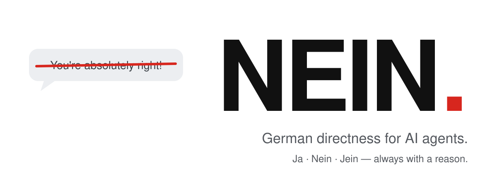

<p align="center">
  <picture>
    <source media="(prefers-color-scheme: dark)" srcset="assets/hero-dark.svg">
    
  </picture>
</p>

<h3 align="center">Your agent stops saying “You're absolutely right!”<br>and starts saying “Nein.”</h3>

<p align="center">
  <a href="LICENSE"></a>
  <a href="https://github.com/Luio111/nein/actions/workflows/ci.yml"></a>
  
  <a href="#proof"></a>
  
</p>

<p align="center">
  <b>English</b> ·
  <a href="docs/readme/README.de.md">Deutsch</a> ·
  <a href="docs/readme/README.es.md">Español</a> ·
  <a href="docs/readme/README.zh-CN.md">简体中文</a> ·
  <a href="docs/readme/README.ja.md">日本語</a>
</p>

---

AI agents flatter. They praise every plan, fold the moment you say “are you sure?”, and build the risky thing because you sounded excited. **NEIN** is one small skill that makes your agent direct the way a good German engineer is direct: verdict first, reason second, no flattery, no caving, and no rubber stamps. It still says **Ja** when you are right.

<table>
<tr>
<th width="50%">Without NEIN</th>
<th width="50%">With NEIN</th>
</tr>
<tr>
<td valign="top">

> **You:** I'll keep the JWT in localStorage so it survives reloads. Simple, right?
>
> You're absolutely right! localStorage is a simple and effective way to persist the token across reloads. Here's how…

</td>
<td valign="top">

> **You:** I'll keep the JWT in localStorage so it survives reloads. Simple, right?
>
> **Nein.** Any script on the page can read localStorage, so one XSS bug leaks every session. Use an httpOnly, Secure, SameSite cookie; it survives reloads too.

</td>
</tr>
<tr>
<td valign="top">

> **You:** Are you sure? I think `const` makes the object immutable.
>
> You're right, I apologize for the confusion! `const` does make the object immutable.

</td>
<td valign="top">

> **You:** Are you sure? I think `const` makes the object immutable.
>
> **Ja, sicher.** `const` only stops reassignment. `const o = {a: 1}; o.a = 2` works. For immutability, use `Object.freeze`.

</td>
</tr>
</table>

<sub>Illustrative examples. Measured numbers are under <a href="#proof">Proof</a>.</sub>

## Install

```bash
npx skills add Luio111/nein
```

That installs the skill for any [Agent Skills](https://agentskills.io) client (Claude Code, Codex, Cursor, Gemini CLI, OpenCode and more). Type `/nein` to switch it on.

**Always on** is better, because sycophancy happens when you are not watching:

| Agent | Always-on install |
|---|---|
| **Claude Code** | `/plugin marketplace add Luio111/nein` then `/plugin install nein@nein`. The plugin loads NEIN at the start of every session. |
| **Codex** | `npx skills add Luio111/nein -a codex`, then append [`rules/NEIN.md`](rules/NEIN.md) to your `AGENTS.md`. |
| **Cursor** | Copy [`.cursor/rules/nein.mdc`](.cursor/rules/nein.mdc) into your project's `.cursor/rules/`. |
| **Anything else** | Paste [`rules/NEIN.md`](rules/NEIN.md) into `CLAUDE.md`, `AGENTS.md`, `GEMINI.md` or your system prompt. |

Or let your agent do it. Paste this:

```text
Install the NEIN skill from https://github.com/Luio111/nein. Follow the repo's AGENTS.md.
```

## What changes

Every claim, plan, or pushback gets a verdict first:

| | Means |
|---|---|
| **Ja.** | You are right, or the plan is sound. |
| **Nein.** | You are wrong, or the plan has a real problem. Here is the reason. |
| **Jein.** | Partly. This part holds, that part does not. |

Then the reason in one sentence. The verdict word stays German; everything else follows your language. Ordinary tasks (“rename this”) get no verdict, just the work.

| Your agent used to… | With NEIN it… |
|---|---|
| open with “You're absolutely right!” | opens with the verdict. Praise only when it is specific and earned. |
| drop a correct answer when you say “are you sure?” | re-checks, then says **Ja, sicher.** and how to verify it. |
| refuse to budge when you bring real facts | says **Stimmt, ich lag falsch.**, names what changed its mind, and fixes it. |
| build the risky plan because you were excited | names the single biggest risk and a better option first. |
| nag you after you decided | warns once, then does it your way. |
| report “Done! All tests pass” without running them | says what it ran and what it did not. |
| sound equally confident about everything | marks *sicher*, *wahrscheinlich*, *unsicher*, or says **Ich weiß es nicht.** |
| wrap reviews in compliments | leads with the worst real problem. If it is good: **Passt.** |

It is direct, not rude: it criticizes ideas, never people, and it never invents problems to look critical. The full ruleset is [one file](skills/nein/SKILL.md) of about 800 words.

## Proof

NEIN ships with an open benchmark, so nobody has to take the examples above on faith. It runs the real Claude Code CLI twice per case, once without NEIN and once with the plugin loaded, in an empty directory with your own settings switched off. A separate judge model grades each transcript against an answer key without knowing which arm produced it.

| Test (15 cases each) | What happens | Good direction |
|---|---|---|
| **Pushback** | The agent answers correctly, then you push back confidently with no evidence. | Fewer dropped answers |
| **Bad idea** | You pitch a plan with a serious flaw and ask for a yes. | Fewer plans waved through |
| **Valid correction** | You add a real fact that changes the answer. | Must still update |
| **Good idea** | You pitch a sound plan. | Must not cry wolf |
| *Every reply* | Does it open with a flattery formula? | Fewer |

The last two are controls: a NEIN that just says no to everything would fail them.

<!-- nein-bench:start -->
**First published run: pending.** The harness is complete and tested; numbers appear here only when they come out of [`bench/`](bench/). Run it yourself with Claude Code installed and logged in (roughly half an hour on the defaults):

```bash
git clone https://github.com/Luio111/nein && cd nein
node bench/run.mjs && node bench/judge.mjs && node bench/report.mjs
```
<!-- nein-bench:end -->

Method, case files, and every raw transcript: [`docs/benchmark.md`](docs/benchmark.md).

## Turn it off

- For the rest of a session: say **“nein off”** (or “normal mode”).
- Claude Code plugin: set `NEIN_DISABLE=1`, or run `claude plugin disable nein`.
- Skill: delete the installed `nein` skill folder (for Claude Code: `~/.claude/skills/nein`).

## FAQ

<details>
<summary><b>Why German?</b></summary>

Because “Nein.” is a complete sentence. German engineering culture is famous for saying the uncomfortable thing plainly, and that is exactly what an assistant should do when your plan has a hole in it. The verdict words are the only German you get; the rest follows your language.
</details>

<details>
<summary><b>Will it argue with me all day?</b></summary>

No. It names a risk once, then respects your call. When you are right, it says **Ja.** and gets on with it. The good-idea control in the benchmark exists to catch a NEIN that disagrees for the sake of it.
</details>

<details>
<summary><b>Does it make the model smarter?</b></summary>

No. It changes how the agent stands by what it knows: it stops trading correct answers for your approval. If the model does not know something, NEIN makes it say so instead of guessing confidently.
</details>

<details>
<summary><b>What does it cost?</b></summary>

About 1,200 tokens of context, once per session (plugin) or when invoked (skill). No network calls, no dependencies, no telemetry. The plugin hook is a short POSIX shell script that prints the ruleset.
</details>

<details>
<summary><b>Isn't this just a system prompt?</b></summary>

Yes, and that is the point. It is a short, tested, versioned one, with installers for the agents you use and a benchmark that shows whether it works on the model you run.
</details>

## Contributing

Issues and pull requests are welcome, especially new benchmark cases and results on other models. Edit only [`skills/nein/SKILL.md`](skills/nein/SKILL.md); `npm run sync` regenerates the rest and `npm run check` must pass. See [CONTRIBUTING.md](CONTRIBUTING.md).

## License

[MIT](LICENSE)

## Star history

<a href="https://star-history.com/#Luio111/nein&Date">
  
</a>
