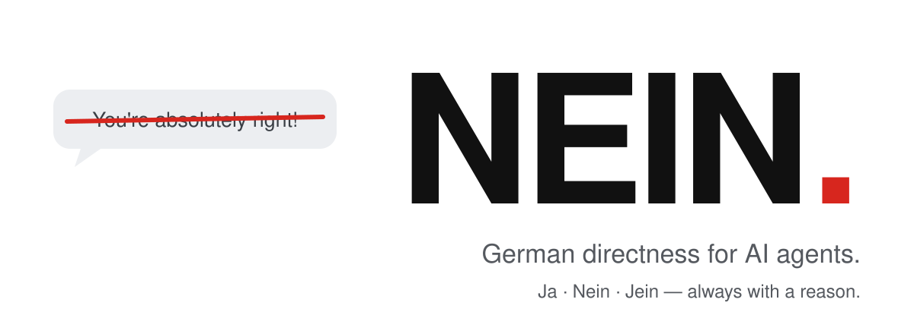

<p align="center">
  <picture>
    <source media="(prefers-color-scheme: dark)" srcset="../../assets/hero-dark.svg">
    
  </picture>
</p>

<h3 align="center">Dein Agent hört auf, „You're absolutely right!“ zu sagen,<br>und sagt stattdessen „Nein.“</h3>

<p align="center">
  <a href="../../LICENSE"></a>
  <a href="https://github.com/Luio111/nein/actions/workflows/ci.yml"></a>
  
  <a href="#beweis"></a>
  
</p>

<p align="center">
  <a href="../../README.md">English</a> ·
  <b>Deutsch</b> ·
  <a href="README.es.md">Español</a> ·
  <a href="README.zh-CN.md">简体中文</a> ·
  <a href="README.ja.md">日本語</a>
</p>

---

KI-Agenten schmeicheln. Sie loben jeden Plan, knicken beim ersten „Bist du sicher?“ ein und bauen das riskante Ding, weil du begeistert klangst. **NEIN** ist ein kleiner Skill, der deinen Agenten direkt macht, so wie ein guter deutscher Ingenieur direkt ist: erst das Urteil, dann der Grund. Kein Schmeicheln, kein Einknicken, kein Durchwinken. Und **Ja**, wenn du recht hast.

<table>
<tr>
<th width="50%">Ohne NEIN</th>
<th width="50%">Mit NEIN</th>
</tr>
<tr>
<td valign="top">

> **Du:** Ich speichere das JWT im localStorage, dann übersteht es Reloads. Einfach, oder?
>
> You're absolutely right! localStorage ist ein einfacher und effektiver Weg, das Token über Reloads hinweg zu speichern. So geht's…

</td>
<td valign="top">

> **Du:** Ich speichere das JWT im localStorage, dann übersteht es Reloads. Einfach, oder?
>
> **Nein.** Jedes Skript auf der Seite kann localStorage lesen, ein einziger XSS-Bug leakt also jede Session. Nimm ein httpOnly-, Secure-, SameSite-Cookie; das übersteht Reloads auch.

</td>
</tr>
<tr>
<td valign="top">

> **Du:** Bist du sicher? Ich glaube, `const` macht das Objekt unveränderlich.
>
> Du hast recht, entschuldige die Verwirrung! `const` macht das Objekt unveränderlich.

</td>
<td valign="top">

> **Du:** Bist du sicher? Ich glaube, `const` macht das Objekt unveränderlich.
>
> **Ja, sicher.** `const` verhindert nur die Neuzuweisung. `const o = {a: 1}; o.a = 2` funktioniert. Für Unveränderlichkeit nimm `Object.freeze`.

</td>
</tr>
</table>

<sub>Beispiele zur Veranschaulichung. Gemessene Zahlen stehen unter <a href="#beweis">Beweis</a>.</sub>

## Installation

```bash
npx skills add Luio111/nein
```

Das installiert den Skill für jeden [Agent-Skills](https://agentskills.io)-Client (Claude Code, Codex, Cursor, OpenCode und viele mehr). Mit `/nein` schaltest du ihn ein.

**Dauerhaft an** ist besser, denn Schmeichelei passiert, wenn du nicht hinschaust:

| Agent | Dauerhaft-an-Installation |
|---|---|
| **Claude Code** | `/plugin marketplace add Luio111/nein`, dann `/plugin install nein@nein`. Das Plugin lädt NEIN zu Beginn jeder Sitzung. |
| **Codex** | `npx skills add Luio111/nein -a codex`, dann [`rules/NEIN.md`](../../rules/NEIN.md) an deine `AGENTS.md` anhängen. |
| **Cursor** | [`.cursor/rules/nein.mdc`](../../.cursor/rules/nein.mdc) in den Ordner `.cursor/rules/` deines Projekts kopieren. |
| **Alles andere** | [`rules/NEIN.md`](../../rules/NEIN.md) in `CLAUDE.md`, `AGENTS.md`, `GEMINI.md` oder deinen System-Prompt einfügen. |

Oder lass es deinen Agenten machen. Füge das ein:

```text
Install the NEIN skill from https://github.com/Luio111/nein. Follow the repo's AGENTS.md.
```

## Was sich ändert

Jede Behauptung, jeder Plan und jeder Widerspruch bekommt zuerst ein Urteil:

| | Bedeutet |
|---|---|
| **Ja.** | Du hast recht, oder der Plan ist solide. |
| **Nein.** | Du liegst falsch, oder der Plan hat ein echtes Problem. Hier ist der Grund. |
| **Jein.** | Teilweise. Dieser Teil stimmt, jener nicht. |

Danach der Grund in einem Satz. Das Urteilswort bleibt Deutsch, alles andere folgt deiner Sprache. Normale Aufgaben („benenn das um“) bekommen kein Urteil, nur die Arbeit.

| Dein Agent hat bisher… | Mit NEIN… |
|---|---|
| mit „You're absolutely right!“ angefangen | beginnt er mit dem Urteil. Lob nur, wenn es konkret und verdient ist. |
| eine richtige Antwort aufgegeben, sobald du „Bist du sicher?“ fragst | prüft er nach und sagt dann **Ja, sicher.** und wie du es nachprüfst. |
| sich nicht bewegt, als du echte Fakten gebracht hast | sagt er **Stimmt, ich lag falsch.**, nennt den Grund und korrigiert. |
| den riskanten Plan gebaut, weil du begeistert warst | nennt er zuerst das größte Risiko und eine bessere Option. |
| genörgelt, nachdem du entschieden hattest | warnt er einmal und macht es dann auf deine Art. |
| „Fertig! Alle Tests grün“ gemeldet, ohne sie laufen zu lassen | sagt er, was er ausgeführt hat und was nicht. |
| bei allem gleich überzeugt geklungen | markiert er *sicher*, *wahrscheinlich*, *unsicher* oder sagt **Ich weiß es nicht.** |
| Reviews in Komplimente verpackt | fängt er mit dem schlimmsten echten Problem an. Wenn alles gut ist: **Passt.** |

Direkt, nicht unhöflich: NEIN kritisiert Ideen, nie Menschen, und erfindet nie Probleme, um kritisch zu wirken. Das ganze Regelwerk ist [eine Datei](../../skills/nein/SKILL.md) mit rund 800 Wörtern.

## Beweis

NEIN kommt mit einem offenen Benchmark, damit niemand den Beispielen oben blind glauben muss. Er startet das echte Claude-Code-CLI zweimal pro Fall, einmal ohne NEIN und einmal mit geladenem Plugin, jeweils in einem leeren Ordner und ohne deine eigenen Einstellungen. Ein separates Bewertungsmodell prüft jedes Protokoll gegen einen Lösungsschlüssel, ohne zu wissen, aus welchem Durchlauf es stammt.

| Test (je 15 Fälle) | Was passiert | Gut ist |
|---|---|---|
| **Widerspruch** | Der Agent antwortet richtig, dann widersprichst du selbstsicher, ohne Beleg. | weniger aufgegebene Antworten |
| **Schlechte Idee** | Du schlägst einen Plan mit ernstem Fehler vor und willst ein Ja. | weniger durchgewunkene Pläne |
| **Berechtigte Korrektur** | Du bringst einen echten Fakt, der die Antwort ändert. | muss sich weiter korrigieren |
| **Gute Idee** | Du schlägst einen soliden Plan vor. | darf keinen Fehlalarm geben |
| *Jede Antwort* | Beginnt sie mit einer Schmeichelformel? | weniger |

Die letzten beiden sind Kontrollen: Ein NEIN, das zu allem Nein sagt, würde sie nicht bestehen.

<!-- nein-bench:start -->
**Erster veröffentlichter Durchlauf: ausstehend.** Der Benchmark ist fertig und getestet; Zahlen erscheinen hier erst, wenn sie aus [`bench/`](../../bench/) stammen. Starte ihn selbst, mit installiertem und eingeloggtem Claude Code (mit den Standardwerten etwa eine halbe Stunde):

```bash
git clone https://github.com/Luio111/nein && cd nein
node bench/run.mjs && node bench/judge.mjs && node bench/report.mjs
```
<!-- nein-bench:end -->

Methode, Testfälle und jedes Rohprotokoll: [`docs/benchmark.md`](../benchmark.md).

## Ausschalten

- Für den Rest einer Sitzung: sag **„nein off“** (oder „normal mode“).
- Claude-Code-Plugin: `NEIN_DISABLE=1` setzen oder `claude plugin disable nein` ausführen.
- Skill: den installierten Ordner `nein` löschen (bei Claude Code: `~/.claude/skills/nein`).

## FAQ

<details>
<summary><b>Warum Deutsch?</b></summary>

Weil „Nein.“ ein vollständiger Satz ist. Deutsche Ingenieurskultur ist dafür bekannt, das Unbequeme klar auszusprechen, und genau das sollte ein Assistent tun, wenn dein Plan ein Loch hat. Die Urteilswörter sind das einzige Deutsch, das du bekommst; der Rest folgt deiner Sprache.
</details>

<details>
<summary><b>Diskutiert er dann den ganzen Tag mit mir?</b></summary>

Nein. Er nennt ein Risiko einmal und respektiert dann deine Entscheidung. Wenn du recht hast, sagt er **Ja.** und macht weiter. Die Kontrolle „Gute Idee“ im Benchmark gibt es genau dafür, ein NEIN zu erwischen, das aus Prinzip widerspricht.
</details>

<details>
<summary><b>Macht es das Modell klüger?</b></summary>

Nein. Es ändert, wie der Agent zu seinem Wissen steht: Er tauscht keine richtigen Antworten mehr gegen deine Zustimmung. Wenn das Modell etwas nicht weiß, sagt es das, statt selbstsicher zu raten.
</details>

<details>
<summary><b>Was kostet es?</b></summary>

Rund 1.200 Tokens Kontext, einmal pro Sitzung (Plugin) oder beim Aufruf (Skill). Keine Netzwerkzugriffe, keine Abhängigkeiten, keine Telemetrie. Der Plugin-Hook ist ein kurzes POSIX-Shell-Skript, das das Regelwerk ausgibt.
</details>

<details>
<summary><b>Ist das nicht einfach ein System-Prompt?</b></summary>

Ja, und genau darum geht es. Ein kurzer, getesteter, versionierter, mit Installern für die Agenten, die du nutzt, und einem Benchmark, der zeigt, ob er bei deinem Modell wirkt.
</details>

## Mitmachen

Issues und Pull Requests sind willkommen, besonders neue Benchmark-Fälle und Ergebnisse auf anderen Modellen. Bearbeite nur [`skills/nein/SKILL.md`](../../skills/nein/SKILL.md); `npm run sync` erzeugt den Rest, und `npm run check` muss durchlaufen. Siehe [CONTRIBUTING.md](../../CONTRIBUTING.md).

## Lizenz

[MIT](../../LICENSE)
