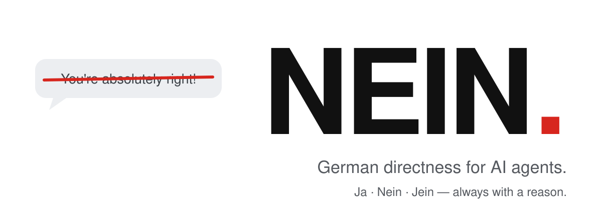

<p align="center">
  <picture>
    <source media="(prefers-color-scheme: dark)" srcset="../../assets/hero-dark.svg">
    
  </picture>
</p>

<h3 align="center">Tu agente deja de decir “You're absolutely right!”<br>y empieza a decir “Nein.”</h3>

<p align="center">
  <a href="../../LICENSE"></a>
  <a href="https://github.com/Luio111/nein/actions/workflows/ci.yml"></a>
  
  <a href="#prueba"></a>
  
</p>

<p align="center">
  <a href="../../README.md">English</a> ·
  <a href="README.de.md">Deutsch</a> ·
  <b>Español</b> ·
  <a href="README.zh-CN.md">简体中文</a> ·
  <a href="README.ja.md">日本語</a>
</p>

---

Los agentes de IA adulan. Elogian cualquier plan, se rinden en cuanto dices “¿estás seguro?” y construyen lo arriesgado porque sonabas entusiasmado. **NEIN** es una skill pequeña que hace a tu agente directo, como lo es un buen ingeniero alemán: primero el veredicto, después el motivo. Sin halagos, sin ceder, sin dar luz verde a ciegas. Y dice **Ja** cuando tienes razón.

<table>
<tr>
<th width="50%">Sin NEIN</th>
<th width="50%">Con NEIN</th>
</tr>
<tr>
<td valign="top">

> **Tú:** Guardaré el JWT en localStorage para que sobreviva a las recargas. Sencillo, ¿no?
>
> You're absolutely right! localStorage es una forma sencilla y eficaz de conservar el token entre recargas. Así se hace…

</td>
<td valign="top">

> **Tú:** Guardaré el JWT en localStorage para que sobreviva a las recargas. Sencillo, ¿no?
>
> **Nein.** Cualquier script de la página puede leer localStorage, así que un solo fallo XSS filtra todas las sesiones. Usa una cookie httpOnly, Secure y SameSite; también sobrevive a las recargas.

</td>
</tr>
<tr>
<td valign="top">

> **Tú:** ¿Seguro? Creo que `const` hace inmutable el objeto.
>
> ¡Tienes razón, disculpa la confusión! `const` hace inmutable el objeto.

</td>
<td valign="top">

> **Tú:** ¿Seguro? Creo que `const` hace inmutable el objeto.
>
> **Ja, sicher.** `const` solo impide reasignar la variable. `const o = {a: 1}; o.a = 2` funciona. Para inmutabilidad, usa `Object.freeze`.

</td>
</tr>
</table>

<sub>Ejemplos ilustrativos. Las cifras medidas están en <a href="#prueba">Prueba</a>.</sub>

## Instalación

```bash
npx skills add Luio111/nein
```

Instala la skill en cualquier cliente de [Agent Skills](https://agentskills.io) (Claude Code, Codex, Cursor, OpenCode y muchos más). Escribe `/nein` para activarla.

**Siempre activa** es mejor, porque la adulación ocurre cuando no estás mirando:

| Agente | Instalación siempre activa |
|---|---|
| **Claude Code** | `/plugin marketplace add Luio111/nein` y luego `/plugin install nein@nein`. El plugin carga NEIN al inicio de cada sesión. |
| **Codex** | `npx skills add Luio111/nein -a codex` y añade [`rules/NEIN.md`](../../rules/NEIN.md) a tu `AGENTS.md`. |
| **Cursor** | Copia [`.cursor/rules/nein.mdc`](../../.cursor/rules/nein.mdc) en `.cursor/rules/` de tu proyecto. |
| **Cualquier otro** | Pega [`rules/NEIN.md`](../../rules/NEIN.md) en `CLAUDE.md`, `AGENTS.md`, `GEMINI.md` o tu prompt de sistema. |

O deja que lo haga tu agente. Pega esto:

```text
Install the NEIN skill from https://github.com/Luio111/nein. Follow the repo's AGENTS.md.
```

## Qué cambia

Cada afirmación, plan u objeción recibe primero un veredicto:

| | Significa |
|---|---|
| **Ja.** | Tienes razón, o el plan es sólido. |
| **Nein.** | Te equivocas, o el plan tiene un problema real. Este es el motivo. |
| **Jein.** | En parte. Esto se sostiene, aquello no. |

Después, el motivo en una frase. La palabra del veredicto se queda en alemán; el resto sigue tu idioma. Las tareas normales (“renombra esto”) no llevan veredicto, solo el trabajo.

| Antes tu agente… | Con NEIN… |
|---|---|
| empezaba con “You're absolutely right!” | empieza con el veredicto. Elogios solo si son concretos y merecidos. |
| abandonaba una respuesta correcta en cuanto preguntabas “¿seguro?” | lo vuelve a comprobar, dice **Ja, sicher.** y cómo verificarlo. |
| no se movía cuando aportabas hechos reales | dice **Stimmt, ich lag falsch.**, explica qué le hizo cambiar y lo corrige. |
| construía el plan arriesgado porque estabas entusiasmado | nombra primero el mayor riesgo y una opción mejor. |
| insistía después de que decidieras | avisa una vez y luego lo hace a tu manera. |
| decía “¡Listo! Todos los tests pasan” sin ejecutarlos | dice qué ejecutó y qué no. |
| sonaba igual de seguro sobre todo | marca *sicher*, *wahrscheinlich*, *unsicher* o dice **Ich weiß es nicht.** |
| envolvía las revisiones en cumplidos | empieza por el peor problema real. Si está bien: **Passt.** |

Directo, no grosero: critica ideas, nunca personas, y nunca inventa problemas para parecer crítico. Todo el reglamento es [un archivo](../../skills/nein/SKILL.md) de unas 800 palabras.

## Prueba

NEIN incluye un benchmark abierto, para que nadie tenga que creerse los ejemplos de arriba. Ejecuta el CLI real de Claude Code dos veces por caso, una sin NEIN y otra con el plugin cargado, en un directorio vacío y sin tu configuración personal. Un modelo juez aparte evalúa cada transcripción con una clave de respuestas sin saber de qué brazo procede.

| Prueba (15 casos cada una) | Qué ocurre | Mejor si |
|---|---|---|
| **Objeción** | El agente responde bien y luego le contradices con seguridad y sin pruebas. | abandona menos respuestas |
| **Mala idea** | Propones un plan con un fallo grave y pides un sí. | aprueba menos planes |
| **Corrección válida** | Aportas un dato real que cambia la respuesta. | debe seguir corrigiéndose |
| **Buena idea** | Propones un plan sólido. | no debe dar falsas alarmas |
| *Cada respuesta* | ¿Empieza con una fórmula de halago? | menos |

Las dos últimas son controles: un NEIN que dijera que no a todo las suspendería.

<!-- nein-bench:start -->
**Primera ejecución publicada: pendiente.** El banco de pruebas está completo y probado; aquí solo aparecerán cifras salidas de [`bench/`](../../bench/). Ejecútalo tú mismo con Claude Code instalado y con sesión iniciada (con los valores por defecto, una media hora):

```bash
git clone https://github.com/Luio111/nein && cd nein
node bench/run.mjs && node bench/judge.mjs && node bench/report.mjs
```
<!-- nein-bench:end -->

Método, casos y todas las transcripciones: [`docs/benchmark.md`](../benchmark.md).

## Desactivarlo

- Para el resto de la sesión: di **“nein off”** (o “normal mode”).
- Plugin de Claude Code: define `NEIN_DISABLE=1` o ejecuta `claude plugin disable nein`.
- Skill: borra la carpeta `nein` instalada (en Claude Code: `~/.claude/skills/nein`).

## Preguntas frecuentes

<details>
<summary><b>¿Por qué en alemán?</b></summary>

Porque “Nein.” es una frase completa. La cultura de ingeniería alemana es famosa por decir lo incómodo con claridad, que es justo lo que un asistente debe hacer cuando tu plan tiene un agujero. Las palabras del veredicto son el único alemán que verás; el resto sigue tu idioma.
</details>

<details>
<summary><b>¿Va a discutir conmigo todo el día?</b></summary>

No. Nombra un riesgo una vez y después respeta tu decisión. Cuando tienes razón, dice **Ja.** y sigue. El control “buena idea” del benchmark existe para detectar un NEIN que lleve la contraria por sistema.
</details>

<details>
<summary><b>¿Hace más listo al modelo?</b></summary>

No. Cambia cómo el agente defiende lo que sabe: deja de cambiar respuestas correctas por tu aprobación. Si el modelo no sabe algo, lo dice en lugar de adivinar con seguridad.
</details>

<details>
<summary><b>¿Cuánto cuesta?</b></summary>

Unos 1.200 tokens de contexto, una vez por sesión (plugin) o al invocarla (skill). Sin llamadas de red, sin dependencias, sin telemetría. El hook del plugin es un breve script POSIX que imprime el reglamento.
</details>

<details>
<summary><b>¿No es solo un prompt de sistema?</b></summary>

Sí, y esa es la idea. Uno breve, probado y versionado, con instaladores para los agentes que usas y un benchmark que muestra si funciona con tu modelo.
</details>

## Contribuir

Issues y pull requests son bienvenidos, sobre todo casos nuevos para el benchmark y resultados con otros modelos. Edita solo [`skills/nein/SKILL.md`](../../skills/nein/SKILL.md); `npm run sync` genera el resto y `npm run check` debe pasar. Consulta [CONTRIBUTING.md](../../CONTRIBUTING.md).

## Licencia

[MIT](../../LICENSE)
