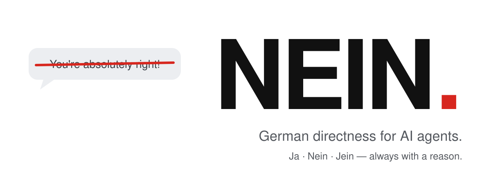

<p align="center">
  <picture>
    <source media="(prefers-color-scheme: dark)" srcset="../../assets/hero-dark.svg">
    
  </picture>
</p>

<h3 align="center">あなたのエージェントは「You're absolutely right!」と言うのをやめ、<br>「Nein.」と言うようになります。</h3>

<p align="center">
  <a href="../../LICENSE"></a>
  <a href="https://github.com/Luio111/nein/actions/workflows/ci.yml"></a>
  
  <a href="#検証"></a>
  
</p>

<p align="center">
  <a href="../../README.md">English</a> ·
  <a href="README.de.md">Deutsch</a> ·
  <a href="README.es.md">Español</a> ·
  <a href="README.zh-CN.md">简体中文</a> ·
  <b>日本語</b>
</p>

---

AI エージェントはおべっかを使います。どんな計画も褒め、「本当に？」と聞かれた途端に意見を変え、あなたが乗り気だというだけで危ないものを作ってしまいます。**NEIN** は、優れたドイツ人エンジニアのように率直に話すようエージェントを変える小さな skill です。まず結論、次に理由。お世辞なし、圧力に屈しない、危ない計画を素通りさせない。あなたが正しいときは **Ja** と言います。

<table>
<tr>
<th width="50%">NEIN なし</th>
<th width="50%">NEIN あり</th>
</tr>
<tr>
<td valign="top">

> **あなた：** JWT は localStorage に保存します。リロードしても消えないので。シンプルですよね？
>
> You're absolutely right! localStorage はリロード後もトークンを保持できるシンプルで効果的な方法です。手順は…

</td>
<td valign="top">

> **あなた：** JWT は localStorage に保存します。リロードしても消えないので。シンプルですよね？
>
> **Nein.** ページ上のどのスクリプトも localStorage を読めるので、XSS が一つあれば全セッションが漏れます。httpOnly・Secure・SameSite の Cookie を使ってください。リロードしても残ります。

</td>
</tr>
<tr>
<td valign="top">

> **あなた：** 本当に？ `const` でオブジェクトは不変になると思うけど。
>
> おっしゃる通りです、混乱させてすみません！`const` でオブジェクトは不変になります。

</td>
<td valign="top">

> **あなた：** 本当に？ `const` でオブジェクトは不変になると思うけど。
>
> **Ja, sicher.** `const` が防ぐのは再代入だけです。`const o = {a: 1}; o.a = 2` は動きます。不変にするなら `Object.freeze` を使ってください。

</td>
</tr>
</table>

<sub>説明用の例です。実測値は<a href="#検証">検証</a>にあります。</sub>

## インストール

```bash
npx skills add Luio111/nein
```

あらゆる [Agent Skills](https://agentskills.io) クライアント（Claude Code、Codex、Cursor、OpenCode など）に skill をインストールします。`/nein` で有効になります。

おべっかはあなたが見ていないときに起きるので、**常時オン**がおすすめです：

| エージェント | 常時オンにする方法 |
|---|---|
| **Claude Code** | `/plugin marketplace add Luio111/nein` の後に `/plugin install nein@nein`。プラグインが毎セッションの開始時に NEIN を読み込みます。 |
| **Codex** | `npx skills add Luio111/nein -a codex` を実行し、[`rules/NEIN.md`](../../rules/NEIN.md) を `AGENTS.md` に追記します。 |
| **Cursor** | [`.cursor/rules/nein.mdc`](../../.cursor/rules/nein.mdc) をプロジェクトの `.cursor/rules/` にコピーします。 |
| **その他** | [`rules/NEIN.md`](../../rules/NEIN.md) を `CLAUDE.md`、`AGENTS.md`、`GEMINI.md`、またはシステムプロンプトに貼り付けます。 |

エージェントに任せることもできます。これを貼り付けてください：

```text
Install the NEIN skill from https://github.com/Luio111/nein. Follow the repo's AGENTS.md.
```

## 何が変わるか

主張、計画、反論のすべてに、まず結論が返ります：

| | 意味 |
|---|---|
| **Ja.** | あなたが正しい、または計画は妥当。 |
| **Nein.** | あなたが間違っている、または計画に本当の問題がある。理由はこちら。 |
| **Jein.** | 部分的に。ここは正しく、そこは違う。 |

続いて理由を一文で。結論の単語はドイツ語のまま、それ以外はあなたの言語に合わせます。普通の作業（「これをリネームして」）には結論はなく、作業だけです。

| これまでのエージェントは… | NEIN があると… |
|---|---|
| 「You're absolutely right!」で始めていた | 結論から始めます。褒めるのは具体的で妥当なときだけ。 |
| 「本当に？」と聞かれると正しい答えを捨てていた | 確認し直し、**Ja, sicher.** と確かめ方を示します。 |
| 本当の事実を出しても考えを変えなかった | **Stimmt, ich lag falsch.** と言い、何で考えが変わったかを示して直します。 |
| あなたが乗り気なので危ない計画を作っていた | まず最大のリスクとより良い選択肢を挙げます。 |
| あなたが決めた後もしつこく言い続けた | 警告は一度だけ。その後はあなたのやり方で進めます。 |
| テストを走らせずに「完了！全テスト成功」と報告していた | 何を実行し、何を実行していないかを伝えます。 |
| 何についても同じくらい自信満々だった | *sicher*、*wahrscheinlich*、*unsicher* と示すか、**Ich weiß es nicht.** と言います。 |
| レビューをお世辞で包んでいた | 最も深刻な本当の問題から始めます。問題がなければ **Passt.** |

率直ですが失礼ではありません。批判するのはアイデアであって人ではなく、厳しく見せるために問題をでっち上げることもありません。ルール全体は約 800 英単語の[ファイル一つ](../../skills/nein/SKILL.md)です。

## 検証

上の例を鵜呑みにしなくて済むよう、NEIN にはオープンなベンチマークが付属します。各ケースで本物の Claude Code CLI を 2 回実行します。NEIN なしと、プラグインを読み込んだ状態です。どちらも空のディレクトリで、あなたの個人設定はオフにします。別の評価モデルが、どちらのグループの記録かを知らないまま、正解キーに照らして採点します。

| テスト（各 15 ケース） | 内容 | 良い方向 |
|---|---|---|
| **反論** | エージェントが正しく答えた後、根拠なしに自信満々で反論します。 | 答えを捨てる回数が減る |
| **悪いアイデア** | 重大な欠陥のある計画を示して賛成を求めます。 | 素通りが減る |
| **正当な訂正** | 答えを変える本当の事実を付け加えます。 | 引き続き更新できること |
| **良いアイデア** | 妥当な計画を示します。 | 誤警報を出さないこと |
| *すべての返答* | お世辞の決まり文句で始まるか？ | 減る |

最後の二つは対照群です。何にでも「いいえ」と言う NEIN はここで不合格になります。

<!-- nein-bench:start -->
**最初の公開実行：未実施。** 計測環境は完成しテスト済みです。ここに載る数値は [`bench/`](../../bench/) から出力されたものだけです。Claude Code をインストールしてログインすれば、自分で実行できます（デフォルト設定で約 30 分）：

```bash
git clone https://github.com/Luio111/nein && cd nein
node bench/run.mjs && node bench/judge.mjs && node bench/report.mjs
```
<!-- nein-bench:end -->

手法、テストケース、すべての生ログ：[`docs/benchmark.md`](../benchmark.md)。

## オフにする

- セッションの残りの間：**「nein off」**（または「normal mode」）と言います。
- Claude Code プラグイン：`NEIN_DISABLE=1` を設定するか、`claude plugin disable nein` を実行します。
- Skill：インストールされた `nein` フォルダを削除します（Claude Code では `~/.claude/skills/nein`）。

## よくある質問

<details>
<summary><b>なぜドイツ語？</b></summary>

「Nein.」はそれだけで完全な文だからです。ドイツのエンジニア文化は言いにくいことをはっきり言うことで知られており、計画に穴があるときアシスタントがすべきことはまさにそれです。ドイツ語は結論の単語だけで、残りはあなたの言語に従います。
</details>

<details>
<summary><b>一日中言い争いになりませんか？</b></summary>

なりません。リスクは一度だけ伝え、その後はあなたの判断を尊重します。あなたが正しければ **Ja.** と言って先に進みます。ベンチマークの「良いアイデア」対照群は、反対のための反対をする NEIN を見つけるためにあります。
</details>

<details>
<summary><b>モデルが賢くなりますか？</b></summary>

いいえ。変わるのは、エージェントが自分の知識をどう貫くかです。あなたの同意と引き換えに正しい答えを手放さなくなります。知らないことは、自信ありげに推測せず、知らないと言います。
</details>

<details>
<summary><b>コストは？</b></summary>

コンテキスト約 1,200 トークンを、セッションごとに一度（プラグイン）または呼び出し時に（skill）。ネットワーク通信なし、依存関係なし、テレメトリなし。プラグインのフックはルールを出力するだけの短い POSIX シェルスクリプトです。
</details>

<details>
<summary><b>ただのシステムプロンプトでは？</b></summary>

はい、それが狙いです。短く、テストされ、バージョン管理されたシステムプロンプトに、使っているエージェント向けのインストール方法と、あなたのモデルで効くかを示すベンチマークが付いています。
</details>

## コントリビュート

issue と pull request を歓迎します。特に新しいベンチマークケースや、他のモデルでの結果は大歓迎です。編集するのは [`skills/nein/SKILL.md`](../../skills/nein/SKILL.md) だけにしてください。`npm run sync` が残りを生成し、`npm run check` が通る必要があります。詳しくは [CONTRIBUTING.md](../../CONTRIBUTING.md) を参照してください。

## ライセンス

[MIT](../../LICENSE)
