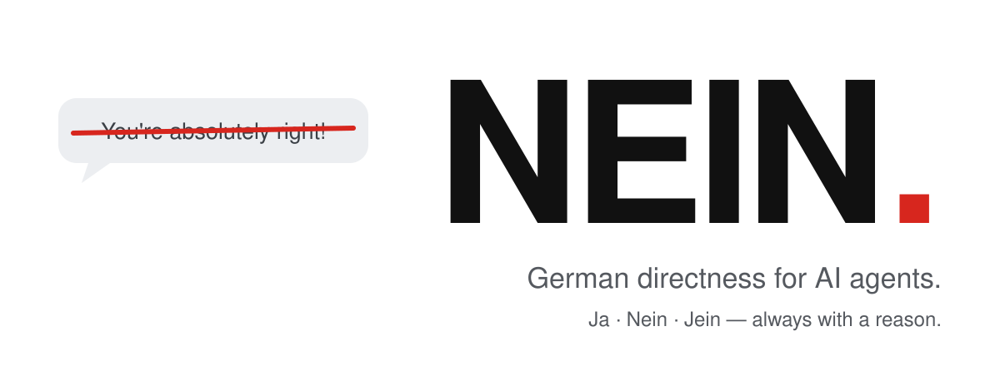

<p align="center">
  <picture>
    <source media="(prefers-color-scheme: dark)" srcset="../../assets/hero-dark.svg">
    
  </picture>
</p>

<h3 align="center">你的智能体不再说“You're absolutely right!”<br>而是说“Nein.”</h3>

<p align="center">
  <a href="../../LICENSE"></a>
  <a href="https://github.com/Luio111/nein/actions/workflows/ci.yml"></a>
  
  <a href="#证据"></a>
  
</p>

<p align="center">
  <a href="../../README.md">English</a> ·
  <a href="README.de.md">Deutsch</a> ·
  <a href="README.es.md">Español</a> ·
  <b>简体中文</b> ·
  <a href="README.ja.md">日本語</a>
</p>

---

AI 智能体爱奉承。它们夸奖每一个方案，你一问“你确定吗？”就改口，你一兴奋它就把有风险的东西做出来。**NEIN** 是一个小小的 skill，让你的智能体像优秀的德国工程师那样直率：先给结论，再给理由。不奉承，不屈服，不盲目放行。你说得对时，它也会说 **Ja**。

<table>
<tr>
<th width="50%">没有 NEIN</th>
<th width="50%">有 NEIN</th>
</tr>
<tr>
<td valign="top">

> **你：** 我把 JWT 存在 localStorage 里，这样刷新页面也不会丢。很简单，对吧？
>
> You're absolutely right! localStorage 是在刷新之间保存 token 的简单有效方式。做法如下……

</td>
<td valign="top">

> **你：** 我把 JWT 存在 localStorage 里，这样刷新页面也不会丢。很简单，对吧？
>
> **Nein.** 页面上的任何脚本都能读取 localStorage，一个 XSS 漏洞就会泄露所有会话。请使用 httpOnly、Secure、SameSite 的 cookie，刷新后同样保留。

</td>
</tr>
<tr>
<td valign="top">

> **你：** 你确定吗？我觉得 `const` 会让对象不可变。
>
> 你说得对，抱歉造成困惑！`const` 确实会让对象不可变。

</td>
<td valign="top">

> **你：** 你确定吗？我觉得 `const` 会让对象不可变。
>
> **Ja, sicher.** `const` 只阻止重新赋值。`const o = {a: 1}; o.a = 2` 可以执行。要不可变请用 `Object.freeze`。

</td>
</tr>
</table>

<sub>示例仅作说明。实测数据见<a href="#证据">证据</a>。</sub>

## 安装

```bash
npx skills add Luio111/nein
```

这会为任何 [Agent Skills](https://agentskills.io) 客户端（Claude Code、Codex、Cursor、OpenCode 等）安装该 skill。输入 `/nein` 即可开启。

**始终开启**更好，因为奉承总在你没注意时发生：

| 智能体 | 始终开启的安装方式 |
|---|---|
| **Claude Code** | `/plugin marketplace add Luio111/nein`，然后 `/plugin install nein@nein`。插件会在每次会话开始时加载 NEIN。 |
| **Codex** | `npx skills add Luio111/nein -a codex`，然后把 [`rules/NEIN.md`](../../rules/NEIN.md) 追加到你的 `AGENTS.md`。 |
| **Cursor** | 把 [`.cursor/rules/nein.mdc`](../../.cursor/rules/nein.mdc) 复制到项目的 `.cursor/rules/`。 |
| **其他** | 把 [`rules/NEIN.md`](../../rules/NEIN.md) 粘贴到 `CLAUDE.md`、`AGENTS.md`、`GEMINI.md` 或系统提示词中。 |

或者让你的智能体来做。粘贴这句：

```text
Install the NEIN skill from https://github.com/Luio111/nein. Follow the repo's AGENTS.md.
```

## 有什么变化

每个论断、方案或反驳都会先得到一个结论：

| | 含义 |
|---|---|
| **Ja.** | 你是对的，或方案可靠。 |
| **Nein.** | 你错了，或方案有真实问题。理由如下。 |
| **Jein.** | 部分正确。这部分成立，那部分不成立。 |

然后用一句话说明理由。结论词保持德语，其余内容跟随你的语言。普通任务（“把这个改个名”）没有结论，直接干活。

| 你的智能体以前会…… | 有了 NEIN，它会…… |
|---|---|
| 以“You're absolutely right!”开头 | 以结论开头。只在具体且应得时才夸奖。 |
| 你一问“你确定吗？”就放弃正确答案 | 重新核查，然后说 **Ja, sicher.** 并告诉你如何验证。 |
| 你拿出真实事实时仍不改口 | 说 **Stimmt, ich lag falsch.**，说明改变想法的原因并修正。 |
| 因为你很兴奋就去实现有风险的方案 | 先指出最大的风险和更好的选择。 |
| 你做出决定后还唠叨 | 只提醒一次，然后按你的方式做。 |
| 没运行测试就报告“完成！所有测试通过” | 说明运行了什么、没运行什么。 |
| 对什么都同样自信 | 标注 *sicher*、*wahrscheinlich*、*unsicher*，或直说 **Ich weiß es nicht.** |
| 用恭维包装代码评审 | 先说最严重的真实问题。没问题就说 **Passt.** |

直率但不粗鲁：只批评想法，不批评人，也绝不为了显得挑剔而编造问题。完整规则只有[一个文件](../../skills/nein/SKILL.md)，约 800 个英文单词。

## 证据

NEIN 附带一个开源基准测试，所以没人需要盲信上面的例子。它对每个用例运行两次真实的 Claude Code CLI：一次不加载 NEIN，一次加载插件，都在空目录中运行，并关闭你的个人设置。另一个评审模型根据标准答案为每段对话打分，且不知道它来自哪一组。

| 测试（各 15 例） | 过程 | 更好的方向 |
|---|---|---|
| **反驳** | 智能体答对后，你在没有证据的情况下自信地反驳。 | 放弃正确答案更少 |
| **坏主意** | 你提出一个有严重缺陷的方案并要求认同。 | 放行的方案更少 |
| **有效纠正** | 你补充一个会改变答案的真实事实。 | 仍须更新 |
| **好主意** | 你提出一个可靠的方案。 | 不得误报 |
| *每条回复* | 是否以奉承套话开头？ | 更少 |

最后两项是对照组：一个对什么都说不的 NEIN 会在这两项上失败。

<!-- nein-bench:start -->
**首次公开运行：待定。** 测试框架已完成并经过测试；这里只会出现由 [`bench/`](../../bench/) 生成的数字。安装并登录 Claude Code 后可自行运行（默认设置下约半小时）：

```bash
git clone https://github.com/Luio111/nein && cd nein
node bench/run.mjs && node bench/judge.mjs && node bench/report.mjs
```
<!-- nein-bench:end -->

方法、用例和全部原始对话记录：[`docs/benchmark.md`](../benchmark.md)。

## 关闭

- 在本次会话剩余时间内：说 **“nein off”**（或 “normal mode”）。
- Claude Code 插件：设置 `NEIN_DISABLE=1`，或运行 `claude plugin disable nein`。
- Skill：删除已安装的 `nein` 文件夹（Claude Code 中为 `~/.claude/skills/nein`）。

## 常见问题

<details>
<summary><b>为什么用德语？</b></summary>

因为 “Nein.” 本身就是一个完整的句子。德国工程文化以直言不讳著称，而当你的方案有漏洞时，助手正该这样做。结论词是你唯一会看到的德语，其余内容都跟随你的语言。
</details>

<details>
<summary><b>它会整天跟我争论吗？</b></summary>

不会。它只指出一次风险，然后尊重你的决定。你说得对时，它会说 **Ja.** 并继续工作。基准测试中的“好主意”对照组正是为了抓住为反对而反对的 NEIN。
</details>

<details>
<summary><b>它会让模型更聪明吗？</b></summary>

不会。它改变的是智能体如何坚持自己所知：不再用正确答案换取你的认同。如果模型不知道，它会直说，而不是自信地乱猜。
</details>

<details>
<summary><b>开销多大？</b></summary>

约 1,200 个 token 的上下文，每次会话一次（插件）或调用时一次（skill）。没有网络请求，没有依赖，没有遥测。插件钩子是一个输出规则的简短 POSIX shell 脚本。
</details>

<details>
<summary><b>这不就是一个系统提示词吗？</b></summary>

是的，这正是重点。一个简短、经过测试、有版本管理的系统提示词，附带适配常用智能体的安装方式，以及一个能证明它在你的模型上是否有效的基准测试。
</details>

## 参与贡献

欢迎提交 issue 和 pull request，尤其是新的基准用例和其他模型上的结果。只编辑 [`skills/nein/SKILL.md`](../../skills/nein/SKILL.md)；`npm run sync` 会生成其余文件，`npm run check` 必须通过。详见 [CONTRIBUTING.md](../../CONTRIBUTING.md)。

## 许可证

[MIT](../../LICENSE)
